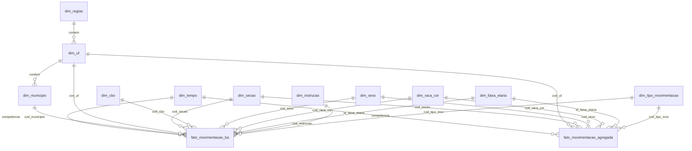

# Equidade no Emprego Formal: Novo CAGED

Projeto prático da disciplina **Big Data e Analytics**.
**Tema 08:** Dinâmica de Emprego Formal e Turnover Setorial (ODS 5 e ODS 18).
**Equipe:** Lucca Barbosa Nygaard e Guilherme de Jesus Duque Teixeira.

O projeto analisa admissões, desligamentos e salários do mercado formal brasileiro,
cruzando **sexo e raça/cor**, a partir dos microdados públicos do Novo CAGED.

---

## Estrutura do repositório

```
caged-equidade/
├── etl/                      Processo de tratamento (Python)
│   ├── config.py             Parâmetros e regras (todas as decisões em um lugar)
│   ├── extract.py            Download do FTP do MTE e descompactação
│   ├── transform.py          Limpeza, tipagem, regras de qualidade e agregação
│   ├── dimensoes.py          Tabelas de dimensão a partir do layout do MTE
│   ├── load.py               Criação do esquema e carga no PostgreSQL
│   └── pipeline.py           Orquestra tudo (ponto de entrada)
├── sql/schema.sql            Estrutura do banco (modelo estrela + views)
├── terraform/                Provisionamento do PostgreSQL na Aiven
├── data/
│   ├── amostra_original/     Primeiras 1.000 linhas do arquivo original, sem alteração
│   ├── processed/            Base tratada exportada (CSV)
│   └── raw/                  Arquivos originais baixados (fora do Git)
├── docs/
│   ├── DECISOES.md           Decisões técnicas e justificativas
│   └── relatorios/           Relatório de cada carga (original x tratado)
├── .env.example              Modelo de variáveis de ambiente
└── requirements.txt
```

## Arquitetura

```
 FTP do MTE (PDET)                 ETL (Python / Pandas)                 Aiven PostgreSQL (Free Tier)
 ┌──────────────────┐   download   ┌─────────────────────────┐   COPY    ┌────────────────────────────┐
 │ CAGEDMOV .7z     │ ───────────► │ extract  → descompacta   │ ────────► │ 11 dimensões               │
 │ CAGEDFOR .7z     │              │ transform → limpa, tipa, │           │ fato_movimentacao_agregada │
 │ CAGEDEXC .7z     │              │             agrega       │           │ fato_movimentacao_ba       │
 │ Layout .xlsx     │              │ load     → grava         │           │ views para o dashboard     │
 └──────────────────┘              └─────────────────────────┘           └────────────────────────────┘
                                              ▲                                        ▲
                                     variáveis de ambiente (.env)            provisionado via Terraform
```

---

## 1. Origem dos dados (versão original)

| Item | Valor |
|---|---|
| Fonte | Microdados Não Identificados do Novo CAGED, Ministério do Trabalho e Emprego |
| Local | `ftp://ftp.mtps.gov.br/pdet/microdados/NOVO CAGED/<ano>/<AAAAMM>/` |
| Formato | `.7z` contendo `.txt` delimitado por `;`, UTF-8, vírgula decimal |
| Arquivos | `CAGEDMOV` (movimentações), `CAGEDFOR` (fora do prazo), `CAGEDEXC` (exclusões) |
| Dicionário | `Layout Não-identificado Novo Caged Movimentação.xlsx` (22 abas de códigos) |
| Versão utilizada | Competência **agosto/2026** (publicada em setembro/2026) |
| Recorte | Brasil inteiro agregado; **Bahia** linha a linha; janela de até 12 meses |
| Características | Base não identificada (sem CPF/nome); 4,4 milhões de linhas/mês; códigos numéricos explicados pelo layout; sexo e raça/cor em todas as linhas |

**Arquivos originais processados nesta versão:**

| Arquivo | Linhas | Colunas | Tamanho |
|---|---|---|---|
| CAGEDMOV202608.txt | 4.423.299 | 28 | 465 MB (51 MB compactado) |
| CAGEDFOR202608.txt | 58.024 | 28 | 6,1 MB |
| CAGEDEXC202608.txt | 13.056 | 30 | 1,5 MB |

Um trecho do arquivo original, sem nenhuma alteração, fica em
`data/amostra_original/` para comparação com a versão tratada.

## 2. Processo de tratamento

O pipeline roda com um comando e executa, em ordem:

1. **Extração:** baixa os três arquivos da competência e o layout do FTP e descompacta (`extract.py`).
2. **Leitura em blocos:** lê 500 mil linhas por vez, só com as colunas necessárias (`transform.py`).
3. **Padronização:** renomeia as colunas para `snake_case` sem acento (ex.: `raçacor` vira `cod_raca_cor`).
4. **Tipagem:** converte texto em inteiro, decimal, booleano e código com zeros à esquerda.
5. **Regras de qualidade:** invalida salários anômalos, trata nulos e gera a faixa etária.
6. **Ajustes oficiais:** soma as declarações fora do prazo (FOR) e desconta as exclusões (EXC) na competência a que pertencem.
7. **Agregação:** monta a fato agregada do Brasil e a fato detalhada da Bahia.
8. **Dimensões:** gera as tabelas de códigos a partir do layout do MTE e completa códigos ausentes.
9. **Exportação:** grava a base tratada em `data/processed/` (CSV).
10. **Carga:** cria o esquema e grava no PostgreSQL com `COPY`, de forma idempotente.
11. **Relatório:** salva em `docs/relatorios/` e na tabela `controle_carga` o que foi lido e o que foi gravado.

As decisões e suas justificativas estão em **[docs/DECISOES.md](docs/DECISOES.md)**.

## 3. Versão tratada (resultado)

Resultado da carga de agosto/2026 (`docs/relatorios/relatorio_carga_202608_202608.json`):

| Indicador | Valor |
|---|---|
| Linhas lidas dos arquivos originais | 4.494.379 |
| Linhas de FOR/EXC de meses fora da janela (descartadas) | 71.080 |
| Linhas da fato agregada (Brasil) | 85.641 |
| Linhas da fato detalhada (Bahia) | 176.743 |
| Admissões | 2.294.563 |
| Desligamentos | 2.128.736 |
| **Saldo de empregos** | **+165.827** |
| Salários válidos para análise | 4.093.832 (91,1%) |
| Salários zerados | 55.913 |
| Salários não mensais | 335.973 |
| Salários fora da faixa válida | 8.661 |
| Idades nulas | 2.888 |
| Códigos de CBO ausentes no layout | 12 |

**Validação:** o saldo calculado (+165.827) é **idêntico ao saldo oficial** divulgado
pelo MTE para agosto/2026.

**Base tratada exportada** (`data/processed/`):
- `fato_movimentacao_agregada_202608_202608.csv.gz` (1,1 MB)
- `fato_movimentacao_ba_202608_202608.csv.gz` (2,0 MB)
- `dimensoes/*.csv` (11 tabelas)

---

## 4. Modelagem do banco

**Estratégia:** esquema estrela (*star schema*), com duas tabelas fato de granularidades
diferentes ligadas às mesmas dimensões. Justificativa detalhada em
[docs/DECISOES.md](docs/DECISOES.md#modelagem).



### Tabelas fato

**`fato_movimentacao_agregada`**: Brasil, dados agrupados.
Grão: competência × UF × seção CNAE × sexo × raça/cor × faixa etária × tipo de movimentação.
Chave primária composta pelas 7 colunas do grão.

| Campo | Tipo | Descrição |
|---|---|---|
| competencia | INTEGER (FK) | Mês de referência AAAAMM |
| cod_uf | SMALLINT (FK) | UF (código IBGE) |
| cod_secao | CHAR(1) (FK) | Seção CNAE (setor econômico) |
| cod_sexo | SMALLINT (FK) | 1 Homem, 3 Mulher, 9 Não identificado |
| cod_raca_cor | SMALLINT (FK) | 1 Branca, 2 Preta, 3 Parda, 4 Amarela, 5 Indígena, 6 Não informada, 9 Não identificado |
| id_faixa_etaria | SMALLINT (FK) | Faixa etária (1 a 7; 9 Não informado) |
| cod_tipo_mov | SMALLINT (FK) | Tipo de movimentação (motivo) |
| qtd_admissoes | INTEGER | Total de admissões |
| qtd_desligamentos | INTEGER | Total de desligamentos |
| saldo | INTEGER | Admissões − desligamentos |
| qtd_salario_valido | INTEGER | Quantidade de salários válidos no grupo |
| soma_salario | NUMERIC(16,2) | Soma dos salários válidos (permite média em qualquer recorte) |
| mediana_salario | NUMERIC(12,2) | Salário mediano do grupo |
| mediana_salario_hora | NUMERIC(10,2) | Salário-hora mediano do grupo |

**`fato_movimentacao_ba`**: Bahia, linha a linha (para drill-down).

| Campo | Tipo | Descrição |
|---|---|---|
| id_movimentacao | BIGSERIAL (PK) | Identificador gerado na carga |
| competencia | INTEGER (FK) | Mês AAAAMM |
| cod_municipio | CHAR(6) (FK) | Município (IBGE) |
| cod_uf | SMALLINT (FK) | UF |
| cod_secao | CHAR(1) (FK) | Seção CNAE |
| cod_cbo | CHAR(6) (FK) | Ocupação (CBO 2002) |
| cod_sexo | SMALLINT (FK) | Sexo |
| cod_raca_cor | SMALLINT (FK) | Raça/cor |
| id_faixa_etaria | SMALLINT (FK) | Faixa etária (a idade exata não é gravada) |
| cod_instrucao | SMALLINT (FK) | Grau de instrução |
| cod_tipo_mov | SMALLINT (FK) | Tipo de movimentação |
| saldo | SMALLINT | 1 admissão, −1 desligamento |
| peso | SMALLINT | 1 registro normal, −1 registro cancelado (EXC) |
| origem | CHAR(3) | Arquivo de origem: MOV, FOR ou EXC |
| horas_contratuais | NUMERIC(5,2) | Horas semanais contratadas |
| salario | NUMERIC(12,2) | Salário mensal (NULL quando inválido) |
| salario_hora | NUMERIC(10,2) | salário ÷ (horas × 4,33) |
| fl_salario_valido | BOOLEAN | Salário passou nas regras de qualidade |
| fl_intermitente | BOOLEAN | Trabalho intermitente |
| fl_parcial | BOOLEAN | Trabalho parcial |
| fl_aprendiz | BOOLEAN | Aprendiz |

### Tabelas de dimensão

| Tabela | Chave | Campos | Registros |
|---|---|---|---|
| dim_tempo | competencia INTEGER | ano, mes, nome_mes, data_referencia | 1 |
| dim_regiao | cod_regiao SMALLINT | nome | 6 |
| dim_uf | cod_uf SMALLINT | sigla, nome, cod_regiao (FK) | 28 |
| dim_municipio | cod_municipio CHAR(6) | nome, cod_uf (FK) | 5.659 |
| dim_secao | cod_secao CHAR(1) | descricao | 22 |
| dim_cbo | cod_cbo CHAR(6) | descricao | 2.790 |
| dim_instrucao | cod_instrucao SMALLINT | descricao | 13 |
| dim_sexo | cod_sexo SMALLINT | descricao | 3 |
| dim_raca_cor | cod_raca_cor SMALLINT | descricao | 7 |
| dim_faixa_etaria | id_faixa_etaria SMALLINT | descricao, idade_min, idade_max | 8 |
| dim_tipo_movimentacao | cod_tipo_mov SMALLINT | descricao, classe (Admissão/Desligamento) | 18 |

### Apoio e consumo

- **`controle_carga`**: registro de cada execução (competências, arquivos, linhas lidas e gravadas, relatório completo em JSON).
- **`vw_movimentacao_brasil`**: fato agregada com todas as descrições. **Oculta as medianas de salário de grupos com menos de 5 salários válidos** (LGPD).
- **`vw_movimentacao_ba`**: fato da Bahia com as descrições.
- **`vw_gap_salarial_admissao`**: salário médio de admissão por sexo × raça/cor.

### Quantidade de dados armazenados

Medido no PostgreSQL após a carga de agosto/2026:

| Tabela | Linhas | Tamanho (com índices) |
|---|---|---|
| fato_movimentacao_ba | 176.743 | 25,6 MB |
| fato_movimentacao_agregada | 85.641 | 10,4 MB |
| dim_municipio | 5.659 | 0,5 MB |
| dim_cbo | 2.790 | 0,3 MB |
| Demais 9 dimensões | 106 | 0,3 MB |
| **Banco completo** | | **44,6 MB** |

**Projeção para 12 meses:** cerca de 36 MB por mês de fatos, ou seja,
aproximadamente **435 MB**, dentro do limite de 1 GB do plano gratuito.

---

## 5. Infraestrutura

| Item | Detalhe |
|---|---|
| Nuvem | Aiven (plano gratuito) |
| Serviço | PostgreSQL 16 gerenciado, 1 nó, 1 GB de disco |
| Ferramenta de provisionamento | Terraform 1.5+ com o provider oficial `aiven/aiven` (v4) |
| Processamento | Python 3.11+ (Pandas, NumPy, psycopg2, py7zr), executado localmente |
| Versionamento | Git / GitHub |

**Recursos provisionados pelo Terraform** (pasta `terraform/`):

| Recurso | O que cria |
|---|---|
| `aiven_pg.caged` | O serviço PostgreSQL na Aiven (plano, região e versão definidos em variáveis) |
| `aiven_pg_database.caged` | O banco `caged` dentro do serviço, usado pelo ETL |

**Arquivos:**
- `main.tf` → provider e recursos
- `variables.tf` → parâmetros (token, projeto, plano, região, versão); o token é marcado como `sensitive`
- `outputs.tf` → endereço, porta, usuário e a `database_url` (senha marcada como `sensitive`)
- `terraform.tfvars.example` → modelo para preencher as credenciais

As tabelas não são criadas pelo Terraform: o ETL executa `sql/schema.sql` (idempotente) a cada carga. Assim, o Terraform cuida só da infraestrutura e o código cuida da estrutura dos dados.

## 6. Segurança das informações

**Estratégia:** nenhuma credencial é escrita no código. Todas ficam em arquivos locais que o Git ignora, e o repositório só traz **modelos** desses arquivos, sem valores reais.

| Credencial | Onde fica | Protegida por |
|---|---|---|
| Token de API da Aiven | `terraform/terraform.tfvars` | `.gitignore` (`*.tfvars`) |
| Senha e endereço do banco | `.env` (`DATABASE_URL`) | `.gitignore` (`.env`) |
| Estado do Terraform (contém a senha do banco) | `terraform/terraform.tfstate` | `.gitignore` (`*.tfstate`) |

Outras medidas:
- **Modelos sem segredo:** `terraform.tfvars.example` e `.env.example` mostram o formato esperado, com valores fictícios.
- **Variáveis sensíveis:** o token e a senha são marcados como `sensitive` no Terraform e não aparecem na tela no `plan` nem no `apply`. A senha só é exibida com `terraform output -raw`.
- **Código lê do ambiente:** `etl/config.py` monta a conexão a partir de `DATABASE_URL` (ou `PGHOST`, `PGPASSWORD` etc.). Trocar a senha não exige mudar código.
- **Conexão criptografada:** `sslmode=require` em toda conexão com o banco.
- **Se uma credencial vazar:** gerar um novo token na Aiven e redefinir a senha do serviço. Apagar o arquivo não basta, porque ele fica no histórico do Git.

## 7. Como reproduzir

### Pré-requisitos
- Python 3.11+
- Terraform 1.5+
- Git
- Conta gratuita na Aiven e um token de API (*User profile → Tokens*)
- Os arquivos do CAGED (baixados automaticamente do FTP, ou colocados à mão em `data/raw/`)

### Sequência geral
1. Provisionar o banco com Terraform
2. Configurar as credenciais no `.env`
3. Rodar o ETL (extração → tratamento → carga)
4. Conferir a carga no banco

Os comandos abaixo são para o PowerShell (Windows). No Linux/Mac, troque `copy` por `cp` e `.venv\Scripts\activate` por `source .venv/bin/activate`.

### Passo 1: provisionar o banco (Terraform)
```powershell
cd terraform
copy terraform.tfvars.example terraform.tfvars   # preencher token e projeto
terraform init
terraform plan
terraform apply
terraform output -raw database_url               # copiar para o .env
cd ..
```

### Passo 2: configurar as credenciais
```powershell
copy .env.example .env    # colar a DATABASE_URL obtida no passo anterior
```

### Passo 3: rodar o ETL
```powershell
python -m venv .venv
.venv\Scripts\activate          # Windows  (Linux/Mac: source .venv/bin/activate)
pip install -r requirements.txt

python etl\pipeline.py --competencias 202608     # um mês
python etl\pipeline.py --ultimos 12              # janela de 12 meses
```

Resultado esperado para agosto/2026: `saldo: 165827` (igual ao número oficial do MTE).

Se o FTP estiver fora do ar, coloque os arquivos `.7z` (ou as pastas já
descompactadas) e o layout em `data/raw/` e rode com `--sem-download`.
Para só gerar os CSVs tratados, sem banco, use `--sem-banco`.

### Passo 4: conferir
```sql
SELECT * FROM controle_carga ORDER BY id_carga DESC LIMIT 1;
SELECT * FROM vw_gap_salarial_admissao;
```

---

## LGPD

- Os microdados já são publicados sem identificação (sem nome, CPF, PIS ou CNPJ).
- A idade exata não é gravada, só a faixa etária.
- As views de consumo ocultam as medianas de salário de grupos com menos de 5 registros, e o painel aplica a mesma regra depois de agrupar.
